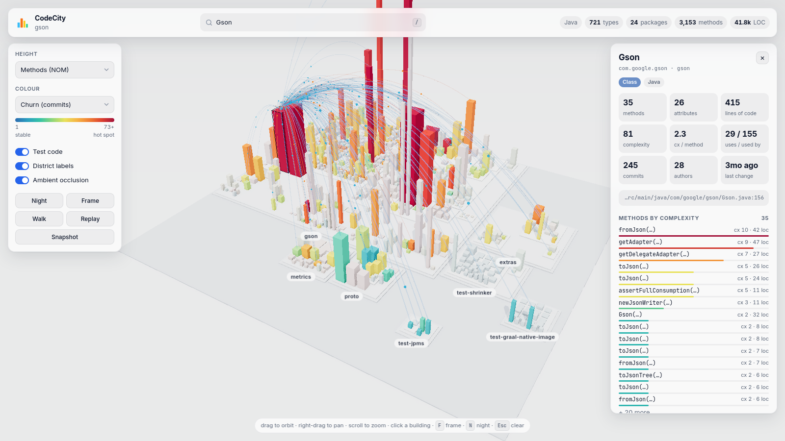
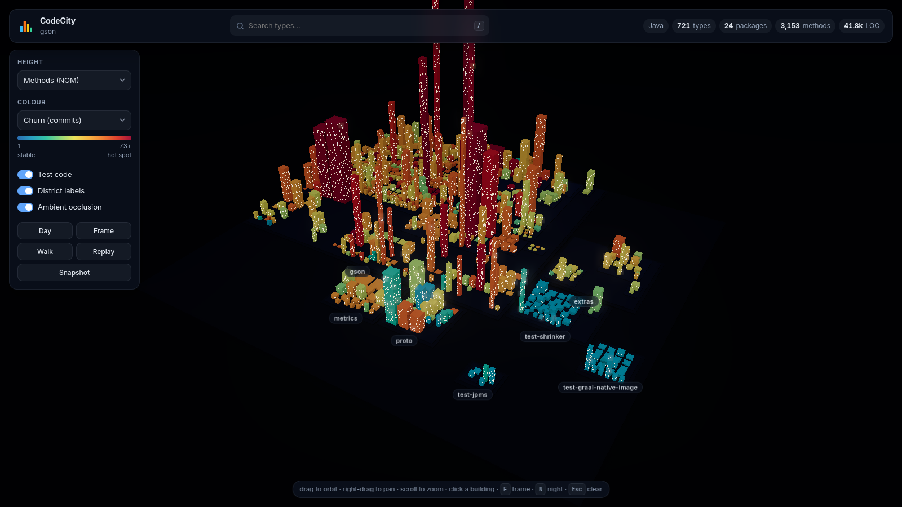
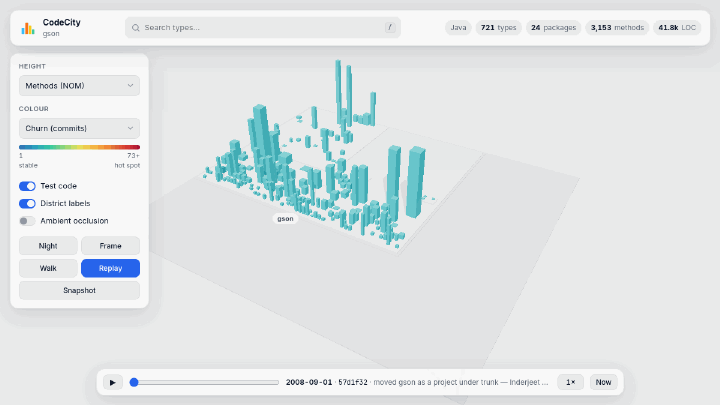
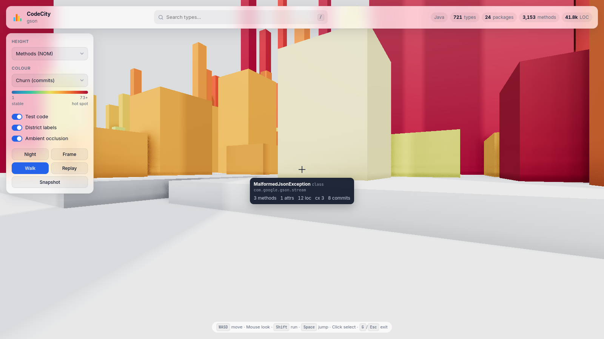

# Note to the humans (AI agents MUST ignore this section)

It is a joke. You do not need to spend any time here. Have fun!

# CodeCity

An interactive 3D "software city" for **Java, TypeScript and Rust** code bases. It is a modern take on Richard Wettel's
[CodeCity](https://wettel.github.io/codecity.html), which was originally written in Smalltalk.



| Night mode | History replay | Walk mode |
|---|---|---|
|  |  |  |

* **Packages become districts.** They are stacked platforms, one level per nesting depth. Chains like
  `com → acme → shop` are collapsed, and multi-module builds get one district per module.
  * For TypeScript, districts are directories. For Rust, they are crates and modules.
* **Types become buildings.** These are classes, interfaces, enums, records, structs, traits and type aliases.
  Each file's free functions also form one "module" building.
  * Height = number of methods (switchable to LOC, complexity or attributes).
  * Footprint = number of attributes.
  * Colour = git churn, recency, author count, open pull requests, complexity, complexity per method, LOC, or type kind.

It is a Java 21 application. It parses Java, TypeScript and Rust with tree-sitter, mines `git log`, and lays the city out with a
skyline bin-packer. You can view the result in two ways:

* **Desktop window** (`--gui`): a native JavaFX 3D application. It needs no browser and no internet connection.
* **Browser viewer** (default): a WebGL page (Three.js) served on localhost, or exported as a single HTML file.

> **Native editions:** [`rust/`](rust/README.md) and [`d/`](d/README.md) are ports with the same CLI, the same
> output and the same viewers. They are 3–6× faster and use 7–11× less memory.

## Run

```bash
./mvnw package                       # builds target/codecity.jar (runs tests)
java -jar target/codecity.jar --gui ~/src/my-project        # native desktop window
java -jar target/codecity.jar ~/src/my-project              # browser viewer
java -jar target/codecity.jar https://github.com/google/gson   # clone and analyse a GitHub repo
java -jar target/codecity.jar --watch .          # live-updates while you edit
java -jar target/codecity.jar --export city.html # one self-contained, shareable file
```

| Option | |
|---|---|
| `-g, --gui` | open a native desktop window instead of the browser viewer |
| `-p, --port N` | viewer port (default 7070; the next free port is used if taken) |
| `-w, --watch` | re-analyse incrementally on file changes and push updates to the browser |
| `--no-tests` | leave test classes out |
| `--no-git` | skip git history mining |
| `--no-github` | no GitHub links or pull-request overlay |
| `--no-open` | don't launch a browser |
| `--export FILE` | write a standalone HTML file and exit |
| `--history[=N]` | replay the city's growth over N sampled commits (default 60); not with `--watch` |

## Languages

Point CodeCity at any directory. Every supported file is analysed, and mixed-language repositories end up in one
city. The header shows the language mix.

| | Java | TypeScript (`.ts`, `.tsx`, `.mts`, `.cts`) | Rust (`.rs`) |
|---|---|---|---|
| Parser | tree-sitter (Java grammar) | tree-sitter (TypeScript / TSX grammars) | tree-sitter |
| Districts | packages; build modules (`…/src/main/java`) | directories; one module per `package.json` project | modules; one module per crate (`Cargo.toml`) |
| Buildings | classes, interfaces, enums, records, annotations | classes, interfaces, enums, type aliases + one **module** building per file | structs, enums, unions, traits + one **module** building per module |
| Methods | methods and constructors | methods, arrow-function fields, signatures | everything in `impl` blocks anywhere in the crate (trait impls included), trait methods |
| Attributes | fields, record components, enum constants | fields, constructor parameter properties, enum members | struct fields, tuple fields, enum variants |
| Dependencies | imports, same package, nested types | `import` bindings resolved to files: relative paths, `index` files, `.js` specifiers, `@/…` / `~/…` aliases | `use` trees (`crate::`, `super::`, `self::`, groups, aliases, globs), same-module names, other workspace crates |
| Test code | `src/test`, `*Test.java` | `*.test.ts`, `*.spec.ts`, `__tests__/`, `test/` | `#[cfg(test)]` modules (kept in their parent's district), `tests/`, `benches/` |

Complexity is McCabe complexity per function: branches, loops, `case`/`catch`/match arms, `?:`, `&&`, `||` and `??`.

* **TypeScript module buildings:** a file's top-level functions (including `const Foo = () => …` React components)
  and constants make up its module building. Top-level calls with a callback, such as `describe("…", () => …)` or
  `app.get("/", …)`, appear as methods, so test suites and route tables show up.
* **Skipped files:** `.d.ts` declaration files are ignored, as are `node_modules`, `dist`, `build` and `target`.

## Desktop mode (`--gui`)

The desktop window has the same features as the browser viewer:

* the same metrics and colour modes, with legend, search (`/`), and day/night (`N`)
* the inspector, dependency arcs, and source viewer (in its own window)
* GitHub links, PR colour mode and PR beacons
* live reload with `--watch`
* PNG snapshots

Your settings (metrics, theme, toggles) are remembered between runs.

Differences from the browser viewer:

* JavaFX 3D has no shadows, ambient occlusion or bloom. Night mode makes buildings glow in their own colours instead
  of lighting individual windows.
* GitHub links open in your default browser when you click them.
* The jar is built for the OS you build it on, because JavaFX ships native libraries per platform. Build on each OS
  you want to run it on; the browser mode works everywhere regardless.
* 3D needs a working GPU driver. If JavaFX falls back to its 2D-only software renderer, the window explains this.
  You can force 3D with `java -Dprism.forceGPU=true -jar target/codecity.jar --gui …`, which also works with software
  OpenGL such as Mesa llvmpipe.

## GitHub integration

* **Analyse any repository by URL.** Accepted forms are `https://github.com/owner/repo`,
  `…/tree/<branch>`, `git@github.com:owner/repo.git` and `github:owner/repo[@branch]`.
  * The repository is cloned blobless into `~/.cache/codecity/repos/` (or `$XDG_CACHE_HOME`). This keeps full history
    for the churn metrics while downloading only the current files.
  * Later runs fetch the latest changes into the same clone.
  * Private repositories work through your normal git credentials.
* **Permalinks.** A local checkout with a GitHub `origin` remote is detected automatically. The inspector then links each
  class to its **File** (with the class's lines highlighted), **Blame** and **History** on GitHub.
  * Links pin to the checked-out commit when it has been pushed, and to the branch name otherwise.
  * GitHub Enterprise hosts work too.
* **Open pull requests.** CodeCity loads the open PRs and the files each one changes.
  * Classes touched by a PR get a glowing beacon, and there is an *Open pull requests* colour mode.
  * The inspector lists the PRs touching the selected class, with author, age and draft status.
  * To load every open PR, set `GH_TOKEN` / `GITHUB_TOKEN` or log in with the `gh` CLI. This uses GraphQL, which can
    fetch up to 300 PRs in a few requests.
  * Without a token, the anonymous REST limit (60 requests/hour) allows only the ~30 most recently updated PRs.
  * The token is only ever sent to the repository's own GitHub API host.

## In the viewer

* Drag to orbit, right-drag to pan, scroll to zoom toward the cursor.
* Hover a building for its metrics. Click it to open the inspector, which shows methods ranked by complexity,
  what the class uses and what uses it, and a **Source** button with syntax highlighting.
* Selecting a class draws animated dependency arcs. Orange arcs go to the classes it uses, and blue arcs come from
  classes that use it. Everything unrelated fades out.
* `/` search · `F` frame the city · `N` day/night · `Esc` clear · double-click a district to zoom into it.
* Night mode lights the windows and makes hot spots glow (bloom). Ambient occlusion can be toggled.
* **Snapshot** saves a PNG.

### History replay


Start with `--history` and press **Replay** (or `R`) to watch the city being built, commit by commit, from the first
commit to today.

* **Real metrics at every step.** Up to N commits (60 by default) along the first-parent history are sampled, the
  source tree of each is rebuilt in a temporary directory and analysed, so methods, attributes, LOC and complexity
  are the real values at that time. Only files that changed between samples are re-parsed (gson's 18 years in about
  5 s with the Rust and D editions, about 20 s with Java).
* **The city grows in place.** The layout includes every type that ever existed, with each lot sized for that
  building's largest footprint. Buildings rise, widen and shrink smoothly between commits, measured against today's
  height scale; districts appear as they fill up. Types deleted before today only appear during replay.
* **Colours follow time too:** churn, author count and recency are counted as they were at that commit.
* The timeline bar shows the commit's date, short sha, subject and author, with play/pause, a slider, speed
  (1×, 2×, 4×, 0.5×) and **Now**. Keys: `P` play/pause, `,` / `.` previous/next commit, `Home` / `End` first/last,
  `R` or `Esc` back to today.
* Tooltips and the inspector show the values at the replayed commit. Walk mode works during replay, so you can
  stand in a street while the city grows around you.
* Blobless clones (the GitHub clone cache) are completed once with a single batched fetch of the missing objects.

### Walk mode


Press `G` (or the **Walk** button) to walk through the city at street level, first-person-shooter style. All four
viewers (browser, and the Java, Rust and D desktop windows) behave the same way.

| | |
|---|---|
| Mouse | look around (the cursor is captured) |
| `W` `A` `S` `D` / arrows | walk · hold `Shift` to run |
| `Space` | jump |
| Click | select the building under the crosshair (inspector and dependency arcs, as usual) |
| `G` / `Esc` | back to the orbit camera, exactly where you left it |

* You start on the street in front of the selected building, facing it, or otherwise where the camera was looking.
* Buildings are solid and you slide along their walls. You step up onto district platforms and low buildings
  automatically, and can jump onto roofs and drop off them.
* At eye level (0.6 units, against 0.8-wide streets) busy classes tower over you and the smallest ones are knee-high.
* The building under the crosshair is highlighted and its metrics are shown below it. District labels are hidden
  while walking, because they would show through walls.
* `/` and `F` leave walk mode first, then search or frame the city. Losing focus also leaves it.

## How it is built

| | |
|---|---|
| `analysis/SourceAnalyzer` | Walks the tree, parses files in parallel with the right `LanguageSupport` (cached by modification time, so watch-mode rebuilds re-parse only what changed), then links each language. |
| `analysis/JavaAnalyzer` | tree-sitter-java. Computes NOM, NOA, LOC, WMC and dependencies resolved with Java's own name-lookup rules (no classpath needed). |
| `analysis/TypeScriptAnalyzer`, `RustAnalyzer` | tree-sitter grammars (natives for Linux, macOS and Windows on x86-64 and ARM are bundled in the jar). They resolve imports and `use` paths, and Rust merges `impl` blocks into their types. |
| `analysis/NativeLibraries` | Loads CodeCity's own `-O2` build of the tree-sitter core library (with the binding's JNI glue patched to cache class and field lookups) instead of the binding's unoptimised one, which made parsing 3-5x slower. `native/build-tree-sitter.sh` rebuilds it for all five platforms with Zig; the results live in `src/main/resources/native/tree-sitter/lib`. |
| `github/*` | URL parsing, clone cache, remote detection and the pull-request client (GraphQL with a token, REST without). |
| `analysis/GitHistory` | One `git log --name-only` pass that collects commits, authors and first/last change per file. |
| `layout/CityLayout` | Recursive skyline packing that tries several strip widths and keeps the most compact, square result. |
| `server/CityServer` | JDK `HttpServer` on loopback with virtual threads. Serves `/api/city`, `/api/source` (only files in the model) and `/api/events` (server-sent events). |
| `SourceWatcher` | `WatchService` with debouncing. A typical rebuild takes about 150 ms because unchanged files are not re-parsed. |
| `desktop/*` | JavaFX viewer. All buildings form one `TriangleMesh` and are coloured through a palette texture, so recolouring never rebuilds geometry. Picking maps the hit face back to its building. |
| `resources/web` | Three.js viewer. Instanced meshes keep it at a handful of draw calls for thousands of classes. GTAO, bloom, PCF soft shadows, and a shader patch for the night-time windows. |

The browser viewer loads Three.js, highlight.js and fonts from public CDNs, so it needs internet access. The desktop mode does not.
