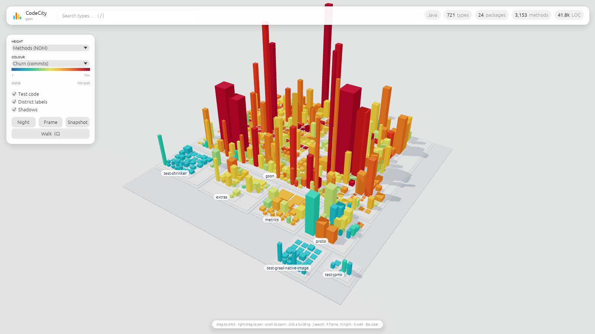

# CodeCity — Rust edition

A native port of CodeCity with the same features and the same output, but 10–19× faster and using about a tenth of the
memory.

* **Same CLI:** the flags are identical to the Java version.
* **Same JSON:** the city model is byte-compatible with the Java version's.
* **Same browser viewer:** the web viewer files are compiled in directly from `../src/main/resources/web`, so both
  editions always serve the same viewer.

```bash
cargo build --release                       # → target/release/codecity (one self-contained binary)
./target/release/codecity ~/src/project     # browser viewer
./target/release/codecity --gui ~/src/project
./target/release/codecity https://github.com/google/gson --watch
./target/release/codecity --export city.html .
```

The build needs a C compiler, because the tree-sitter grammars are C (on Debian/Ubuntu:
`sudo apt install build-essential`). For a CLI-only build without the desktop window, which is smaller and quicker to
compile, use `cargo build --release --no-default-features`.

## Performance

Wall time and peak memory, analysing and exporting the whole city with git history:

| Code base | Java edition | Rust edition |
|---|---|---|
| google/gson — 721 Java types | 2.7 s · 191 MB | **0.26 s · 16 MB** |
| colinhacks/zod — 1,761 TypeScript types | 10.0 s · 204 MB | **0.65 s · 29 MB** |
| BurntSushi/ripgrep — 500 Rust types | 4.2 s · 178 MB | **0.22 s · 23 MB** |

Where the time went in the Java edition:
* **JVM startup.**
* **The JNI tree-sitter bindings:** one native call per syntax-tree node.

The Rust edition instead:
* parses with native tree-sitter,
* walks the tree with a cursor (no allocation per node),
* parses files in parallel (rayon),
* mines `git log` concurrently with parsing.

Watch-mode rebuilds re-parse only the files that changed.

## Parity

Both editions produce identical cities, checked field by field on the code bases above: every building, metric,
position, district and dependency edge. Java parsing differs underneath (tree-sitter-java here, JavaParser there), so
the Java analyser mirrors JavaParser's rules, for example `case 1, 2 ->` counting as one decision and `Map.Entry`
referencing `Map`. The layout is a line-by-line port, so floating-point results match exactly.

## Desktop mode



`--gui` opens a native OpenGL window (three-d + egui) with the same features as the other viewers. Compared with the
JavaFX window it adds:

* **Real soft shadows** (toggleable).
* **The browser viewer's night look:** buildings glow in their own colour and office windows light up, via a custom
  shader.
* **GPU picking**, and every building and district instanced, so even very large cities are a handful of draw calls.
* **History replay** (`--history`, then `R`): watch the city grow commit by commit, as described in the
  [main README](../README.md#history-replay).
* **Walk mode** (`G`): walk through the city in first person, as described in the
  [main README](../README.md#walk-mode).

Snapshots go to `~/Pictures` (or the current directory if that doesn't exist), and settings are saved in
`~/.config/codecity/desktop.json`. It also runs on software OpenGL (Mesa llvmpipe) with no extra flags.

## Layout

| | |
|---|---|
| `src/analysis/` | Source walker and cache (`mod.rs`), and one tree-sitter analyser per language: `java.rs`, `typescript.rs`, `rust_lang.rs`. |
| `src/layout.rs` | Skyline bin-packing of districts and buildings. |
| `src/city.rs`, `src/json.rs` | The resolved city model and its JSON form. |
| `src/git.rs`, `src/github.rs` | Churn/authors/recency mining; GitHub URLs, clone cache, permalinks and open pull requests. |
| `src/server.rs`, `src/export.rs`, `src/watch.rs` | Local web server with live-reload events, single-file HTML export, and the file watcher. |
| `src/gui/` | Desktop viewer: scene, custom building material, egui interface, source viewer. |

`cargo test` runs the analyser, layout, JSON, GitHub and source-highlighting tests.
